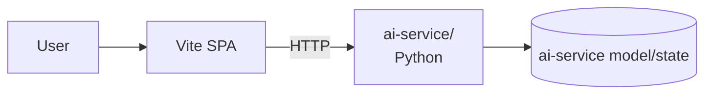

# VidAI — Agent Briefing

> A two-tier app: a **Vite** frontend (default React template README — likely needs replacement) and a Python **ai-service/** backend with its own `.venv` and `Dockerfile`. Has a `dist/` build artifact committed, three run/guide docs (`README.md`, `GUIDE.md`, `RUN.md`), and an `nul` 0-byte file (Windows command-output accident).

## 1. Identity
- **Name:** VidAI
- **Path:** `C:\Users\Atta\Documents\Projects\VidAI`
- **Category:** webapp
- **Lifecycle stage:** dev (frontend scaffold + Python AI service)
- **Hypothesis confirmed:** yes — Vite frontend + Python AI service.
- **Repo health:** 2/5 — Vite README is the default template, `nul` and `dist/` committed, real docs in `GUIDE.md`/`RUN.md`.

## 2. Tech Stack
- **Frontend:** Vite + React + TS, ESLint config present, React Compiler enabled.
- **Backend:** Python (per `ai-service/.venv/` and `ai-service/requirements.txt`).
- **Container:** `ai-service/Dockerfile`, plus an `ai-service/.dockerignore`.
- **Build artefact:** `dist/` (built Vite output — should not be committed).

## 3. Repository Layout
```
VidAI/
├─ README.md            # ⚠️ default Vite template — replace
├─ GUIDE.md             # real guide (6.7KB)
├─ RUN.md               # real run guide (2.5KB)
├─ eslint.config.js
├─ index.html
├─ package.json (1KB)
├─ package-lock.json (112KB)
├─ vite.config.js
├─ dist/                # built output — should be gitignored
│  ├─ assets/
│  └─ index.html
├─ ai-service/
│  ├─ .dockerignore
│  ├─ .env             # real env present — audit
│  ├─ .venv/           # committed
│  ├─ Dockerfile
│  ├─ app/             # FastAPI? read
│  ├─ requirements.txt
│  └─ nul              # 0-byte — Windows command-output accident, delete
├─ .venv/, .ruff_cache/, .tmp/, .vscode/
└─ nul                 # 0-byte at root — delete
```

## 4. Architecture
A Vite SPA that calls a Python AI service over HTTP. The `ai-service/` has its own venv and Dockerfile, so it's intended to be built and run separately.



## 5. Data Layer
- Not visible at top level — check `ai-service/app/`.

## 6. APIs and Interfaces
- HTTP between the SPA and the Python service. Read `ai-service/app/` to enumerate routes.
- `GUIDE.md` and `RUN.md` likely document the surface.

## 7. Configuration
- `ai-service/.env` is present — audit.
- `ai-service/Dockerfile` is the deploy unit.

## 8. Build, Run, Deploy
```bash
# Frontend
npm install
npm run dev
npm run build
# Backend
cd ai-service
docker build -t vidai-ai .
docker run --rm -p 8000:8000 vidai-ai
# or
pip install -r requirements.txt
python -m uvicorn app.main:app --reload   # confirm
```

## 9. Testing
- Not visible at top level. Check `ai-service/tests/`.

## 10. Known Issues and TODOs
- **`nul` 0-byte file at the root AND inside `ai-service/`** — Windows `echo > nul` artefacts. Delete.
- **`dist/` is committed** — gitignore.
- **`.venv/` is committed at both root and `ai-service/`** — gitignore.
- **`README.md` is the default Vite template** — replace with a real one.
- **`ai-service/.env` is committed** — audit keys, gitignore.
- **`.ruff_cache/`, `.tmp/`, `.vscode/`** — should be gitignored.
- **No CI, no healthcheck, no auth on the AI service.**

## 11. Production-Readiness Checklist
| Area | Status | Evidence |
|---|---|---|
| Auth | ❌ | Not visible |
| Secrets | ⚠️ | `ai-service/.env` present |
| Observability | ❌ | Not visible |
| Error handling | ⚠️ | Default FastAPI handlers |
| Rate limiting | ❌ | Not visible |
| CI/CD | ❌ | No `.github/workflows` |
| Backups | N/A | N/A |
| Rollback | ⚠️ | Docker image can be re-pinned |
| Logging | ⚠️ | Not visible |
| PII/GDPR | ⚠️ | Video/AI service — depends on data |
| Cost ceiling | ⚠️ | LLM calls unbounded |

## 12. Next Concrete Steps
1. **Delete `nul` files (root + ai-service)**, `dist/`, both `.venv/`, `.ruff_cache/`, `.tmp/`, `.vscode/`. Add them to `.gitignore`.
2. **Replace `README.md`** with a real project description (lift content from `GUIDE.md`).
3. **Audit `ai-service/.env`** — rotate keys, add to `.gitignore`.
4. **Add a `docker-compose.yml`** that runs frontend + backend together, with healthchecks.
5. **Add a `/health` endpoint** to the Python service.
6. **Add CI** (`npm run build`, `pytest`, `ruff`).
7. **Add auth** to the AI service (API key at minimum).

**Definition of done for v1:** `docker compose up` brings up the whole stack, the SPA loads, the AI service answers a test query, CI is green.

## 13. Pointers for a Fresh Agent
Read in this order:
1. `GUIDE.md` (6.7KB) and `RUN.md` (2.5KB) — the real project docs.
2. `ai-service/app/` — the backend.
3. `ai-service/Dockerfile` — the deploy unit.
4. `vite.config.js` and `package.json` — the frontend.

**Do not touch:** `ai-service/.venv/`, `dist/`, the `nul` files (just delete).

**Anti-patterns to avoid:** committing the default Vite README; shipping the Python service without auth; "deploying" by handing someone a `dist/` folder.

**If you only have 30 minutes:** read `GUIDE.md`, then `ai-service/app/`. The README is misleading; the real info is in the other two docs.

<!-- generated by prime-agent, category=webapp -->
